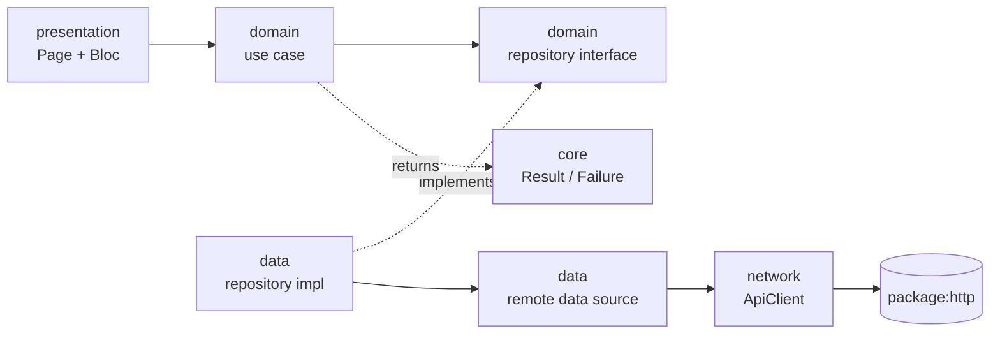

# Flutter BLoC Template

A GitHub template repository for Flutter apps (Android and iOS) built with Clean
Architecture and BLoC. It ships a Melos 7 pub workspace, localization (English and
Croatian), `go_router` navigation, a small design system, an `http`-based network
layer, `dev`/`staging`/`prod` flavors, typed env config and CI/CD (GitHub Actions +
Codemagic). A `posts` demo feature shows the full pattern end to end.

Flutter is pinned in `.fvmrc`, the single source of truth for GitHub Actions and Codemagic.
Design decisions are recorded in [`docs/adr`](docs/adr); see also [CONTRIBUTING.md](CONTRIBUTING.md).

## Architecture

Per feature, dependencies point inward: `presentation` and `data` both depend on
`domain`; `domain` is pure Dart. `get_it` is used only in the composition root
(`apps/app/lib/injection.dart`).



Errors are modelled with a hand-written sealed `Result<T>` (`Success`/`Failure`) and a
sealed `Failure`, both in `core`.

## Package layout

```
apps/app/               app: entrypoints, bootstrap, injection.dart, features/*
  lib/features/<name>/  data/ domain/ presentation/
  config/               <flavor>.example.json
packages/core/          Result, Failure
packages/network/       ApiClient, logging and auth http decorators
packages/design_system/ theme tokens, AppButton, AppTextField, AppLoader, ErrorView, EmptyView
packages/l10n/          ARB (en, hr), LocaleCubit, ThemeCubit, settings page
packages/navigation/    go_router setup and routes
tool/                   init, setup_repo.sh, coverage_check.dart, copilot_review_gate.sh
docs/adr/               architecture decision records
```

## Use this template

1. Click **Use this template** on GitHub (or `gh repo create <name> --template StipT/clean_bloc_template`) and clone your new repo.
2. Run `tool/init` (below) to rename the app, package and bundle IDs.
3. Run `melos bootstrap`.

### Initialising a new app

```bash
tool/init --name "Acme Shop" --package acme_shop --bundle-id com.acme.shop \
  [--repo acme/shop] [--skip-repo-setup] [--dry-run]
```

- `--name`: display name (flavors become `Acme Shop Dev` / `Acme Shop Staging`).
  YAML-reserved characters (such as `:` and `#`) are rejected.
- `--package`: Dart package name (`snake_case`); rewrites pubspecs and all package imports.
- `--bundle-id`: base application/bundle ID; flavors get `.dev` / `.staging`.
  Updates Android `applicationId`/`namespace`/Kotlin package dirs, iOS bundle IDs,
  xcconfigs, flavorizr config, `codemagic.yaml` and this README's title.
- `--dry-run` lists what would change and writes nothing.
- Unless `--skip-repo-setup` is given, it finally runs `tool/setup_repo.sh [--repo]`
  (needs `gh` with admin rights).

`tool/init*` keeps the old names by design and can be deleted afterwards. Tests: `tool/test/init_test.sh`.

## Running

```sh
dart pub global activate melos
melos bootstrap
melos analyze
melos run format:check
```

### Flavors

`dev`, `staging`, `prod` (flutter_flavorizr config lives in `apps/app/pubspec.yaml`;
generated native config is committed). Each has its own app name, bundle/application
ID suffix (`.dev`, `.staging`, none for prod) and icon (dev/staging carry a banner).
Run from `apps/app` (copy `config/<flavor>.example.json` to `config/<flavor>.json` first):

```sh
flutter run --flavor dev -t lib/main_dev.dart --dart-define-from-file=config/dev.json
flutter run --flavor staging -t lib/main_staging.dart --dart-define-from-file=config/staging.json
flutter run --flavor prod -t lib/main_prod.dart --dart-define-from-file=config/prod.json

flutter build apk --flavor prod -t lib/main_prod.dart --dart-define-from-file=config/prod.json
flutter build ipa --flavor prod -t lib/main_prod.dart --dart-define-from-file=config/prod.json
```

All entrypoints call `bootstrap()` (`lib/bootstrap.dart`). To regenerate native config
after editing the `flavorizr:` block: `dart run flutter_flavorizr -f` (in `apps/app`).

## Environment and config

Values come from `--dart-define-from-file=apps/app/config/<flavor>.json` and are read via
`AppConfig`. Copy `apps/app/config/<flavor>.example.json` to `<flavor>.json` (gitignored).
Any value shipped in the client is extractable; never put secrets in these files.
In CI, Codemagic variable groups supply the file contents (see Codemagic below).

## Testing and coverage

```sh
melos test                 # flutter test --coverage in every package with tests
melos run coverage:check   # tests + 90% merged-lcov gate
```

Coverage must stay at or above 90% over the merged lcov report. Exclusions
(`tool/coverage_check.dart`): `*.g.dart`, generated l10n, `main_*.dart`, `injection.dart`.
Tooling tests: `tool/test/init_test.sh`, `tool/test/copilot_review_gate_test.sh`.

## CI (GitHub Actions)

`.github/workflows/pr.yml` runs on pull requests: `lint` (`melos run format:check` +
`melos run analyze`), then `test` (`needs: lint`, runs `melos run coverage:check`).

### Copilot review gate and ruleset

`.github/workflows/copilot-review-gate.yml` requests a Copilot review if none
exists and polls up to ~10 min for a current review and for all Copilot review
threads to be resolved. If it times out, resolve the threads and manually rerun
**Copilot review gate** from Actions with the PR number. Copilot code review
must be enabled for the repo/org; expect some noisy comments. See
`.github/copilot-instructions.md` for layering rules.

Run `tool/setup_repo.sh [owner/repo]` (needs `gh` with admin rights; safe to
re-run; `--dry-run` prints the ruleset) to create the `main-protection` ruleset.

Manual fallback: Settings -> Rules -> Rulesets -> New branch ruleset targeting
the default branch; require a pull request, require status checks `lint`,
`test`, `copilot-review-gate`, and enable "Automatically request Copilot code
review". Tests: `tool/test/copilot_review_gate_test.sh`.

## Codemagic (CD)

`codemagic.yaml` defines four workflows. Each runs `melos bootstrap`, `melos run analyze` and
`melos run test` before building. Flutter version comes from `.fvmrc` (`flutter: fvm`).

| Workflow | Trigger | Output |
| --- | --- | --- |
| `android-staging` | push to `develop` | Firebase App Distribution |
| `ios-staging` | push to `develop` | TestFlight (internal testing only) |
| `android-prod` | tag `v*` | Google Play (`production`, submitted as draft) |
| `ios-prod` | tag `v*` | App Store Connect (upload only) |

Build numbers: `android-staging` uses Codemagic's monotonic `$PROJECT_BUILD_NUMBER` (no Google
Play dependency; its workflow does not use the `google_play` group). `android-prod` and the iOS
workflows use latest store build + 1. Version name comes from `apps/app/pubspec.yaml`.

**Production is never auto-released:** `android-prod` only submits a draft to the Google Play
`production` track and `ios-prod` only uploads to App Store Connect. Promote/submit for review
manually in each store console.

Setup (nothing secret is committed; all values are entered in the Codemagic UI):

1. Add the repo as an application and let Codemagic detect `codemagic.yaml`.
2. Variable groups (mark values *Secret*):
   - `staging_config` / `prod_config`: `APP_CONFIG_JSON` = full contents of the flavor's
     `config/<flavor>.json` (see Environment and config; client-shipped values are not secret).
   - `google_play` (prod workflow only): `GOOGLE_PLAY_SERVICE_ACCOUNT_CREDENTIALS` (service account JSON).
   - `firebase`: `FIREBASE_SERVICE_ACCOUNT` (service account JSON).
3. Team integrations / code signing identities:
   - Developer Portal: App Store Connect API key named `codemagic` (App Manager role).
   - Android keystores named `staging_keystore` and `prod_keystore`.
   - iOS signing is fetched via the API key; `bundle_identifier` is set per workflow.
4. Replace placeholders in `codemagic.yaml`: `FIREBASE_ANDROID_APP_ID`, the
   `APP_STORE_APPLE_ID` values, the Firebase tester group (`testers`), and the
   bundle/package IDs if you renamed them.
5. Create the app records in Google Play and App Store Connect (upload the first build manually).
6. Release: push to `develop` for staging; `git tag v1.2.3 && git push --tags` for prod.

Android release builds sign with the Codemagic keystore only when `CI=true`
(`apps/app/android/app/build.gradle.kts`); locally they still use debug keys.

## Demo feature: posts

`apps/app/lib/features/posts` (data / domain / presentation) lists posts from
JSONPlaceholder (`BASE_URL` must be `https://jsonplaceholder.typicode.com`).
It shows the full pattern: `ApiClient` -> data source -> repository -> use
case -> `PostsBloc` -> `PostsPage`, with loading/error/empty states.

### Removing the demo feature

1. Delete `apps/app/lib/features/posts/` and `apps/app/test/features/posts/`.
2. In `apps/app/lib/injection.dart`, delete the block between
   `--- posts demo feature` and `--- end posts demo feature` (keep `AppConfig`
   and `ApiClient`).
3. In `apps/app/lib/app.dart`, replace the `postsBuilder` page with your own
   home page (and remove the posts imports).
4. Delete the posts assertions in `apps/app/test/app_test.dart` and
   `apps/app/test/injection_test.dart` (or point them at your feature).
5. If unused, drop `bloc_test`/`mocktail`/`http` only after your own tests stop
   needing them; set `BASE_URL` in `apps/app/config/*.json` to your API.
6. Run `melos bootstrap && melos analyze && melos run coverage:check`.

## License

[MIT](LICENSE)
